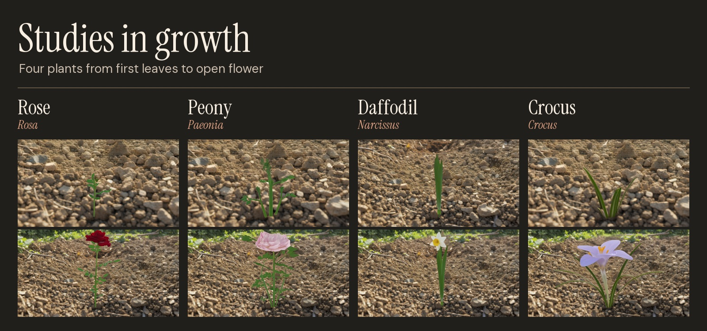

# Huangxiangru's Lab Westlake University

[**Open the plant growth studio ↗**](https://raconiy.github.io/westlake-plant-growth-studio/)

Watch a shoot break through the soil, trace the first leaves up the stem, and see the flower open. Four botanical studies pair a native **1280 × 720** film with the animated 3D plant that guided its growth.

## Explore a plant

- **Scrub the film.** Drag along the filmstrip or jump straight to the sprout, leaves, bud, or open flower.
- **Move the bloom.** Slide the opening time earlier or later to preview a different rhythm. The browser remaps the frames of the existing film immediately.
- **Turn the model.** Switch to **4D model** and drag to rotate the plant at the current frame. **Control pass** shows the image sequence supplied to the video model.

## Watch the films

[Rose](media/rose/film.mp4) · [Peony](media/peony/film.mp4) · [Daffodil](media/daffodil/film.mp4) · [Crocus](media/crocus/film.mp4)

Each film contains 65 native frames and plays at 8 fps. A procedural plant defines the geometry, camera, and growth schedule. A Wan2.1-VACE-1.3B video model with a LoRA trained on paired footage renders the plant against a generated environment. All four examples use seed 43.

At emergence, the shoot starts underground. Its tip lifts a local patch of soil, separates the clods, and passes between them. The clods carry their surface texture as they move. The distant garden uses a generated image projected into the scene. [Compare the first 23 rose frames at half speed.](media/rose/emergence-comparison.mp4)

The public studio plays the rendered films and draws their animated meshes locally. The lab's GPU service handles new prompt-based renders.

## Run locally

From this branch, run `python3 -m http.server 8000` and open [the local studio](http://localhost:8000/).
